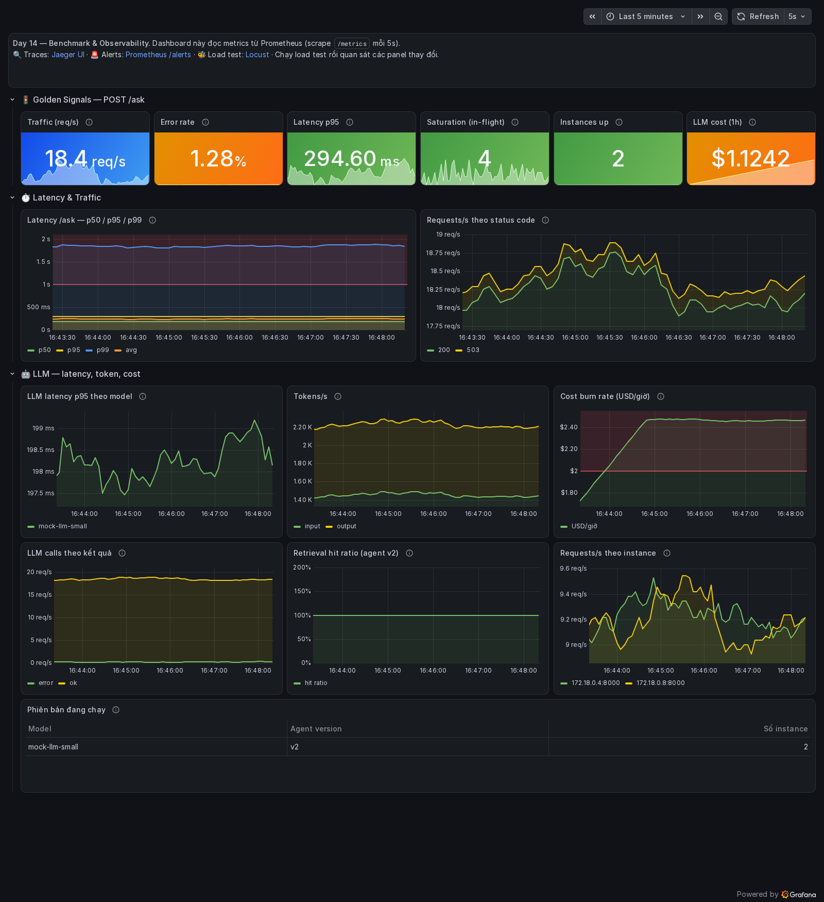
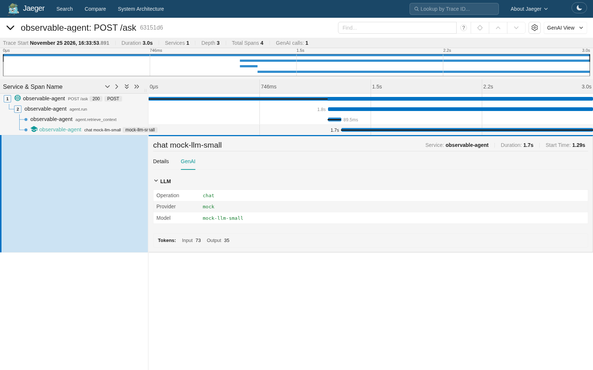
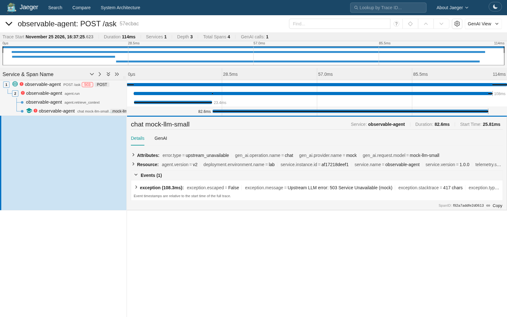
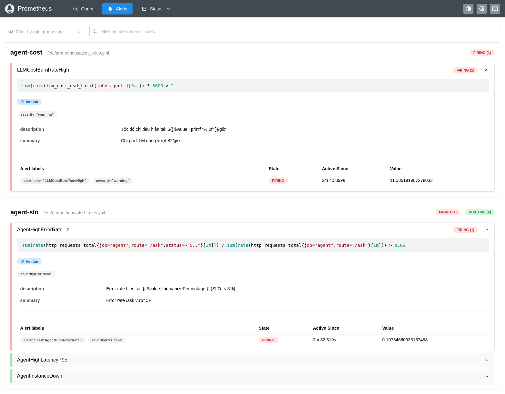

# Benchmark & Observability Report — Day 14

> Mọi con số trong các bảng mục 2 và 3 được copy từ các file JSON trong `06-lab-complete/benchmark-observability/develop/reports/` do chính tôi chạy ra; số ở mục 4, 5 từ `production/benchmark-results/` (CSV Locust, `promql/`, `alerts/`, `traces/`). Quy ước làm tròn và bảng đối chiếu số liệu ở cuối file (Phụ lục, mục F).
> Trạng thái: **hoàn thành** (mục 1–6, Phụ lục A–H). Mục 1, 2, 3 và Phụ lục A–F (Exercise 7.1–7.3) xong ở CP7; mục 4, 5, 6 và Phụ lục G, H (Exercise 7.4–7.7) xong ở CP8. Mọi số ở mục 4, 5, G, H lấy từ các file dưới `06-lab-complete/benchmark-observability/production/benchmark-results/` (xem Phụ lục F).

**Họ tên:** Nguyễn Mạnh Tường (2A202603646)
**Ngày chạy:** 2026-11-25
**Môi trường:** Lenovo ThinkPad X1 Carbon Gen 8 (Intel Core i7-10610U, 8 luồng CPU theo `nproc`, 15 GB RAM theo `free -g`), Ubuntu 22.04.5 LTS (kernel 6.8.0-149), Python 3.11.18, fastapi 0.115.0, prometheus-client 0.26.0, httpx 0.27.2. Mục 2–3 (CP7): chạy local, không dùng Docker; agent (1 process uvicorn) và `load_test.py` chạy **cùng một máy**. Mục 4–5 (CP8): stack Docker Compose (Docker 29.10.1, Compose 5.8.0) trên cùng máy này, image `prom/prometheus:v3.16.0`, `grafana/grafana:13.2.4`, `jaegertracing/jaeger:2.23.0`, `locustio/locust:2.47.0`, `nginx:1.28-alpine`; mỗi agent bị giới hạn `cpus: 0.5`, 256 MB.

---

## 1. SLO của agent

| SLI | SLO | Lý do chọn ngưỡng này |
|---|---|---|
| p95 latency `/ask` | < 500 ms | Khi tải vừa phải, p95 đo được là 224.1 ms (c=1), 231.0 ms (c=10) và 416.2 ms (c=50); ngưỡng 500 ms bằng khoảng 2.2 lần p95 ở c=1 nên đủ biên cho dao động bình thường. Ngưỡng này vẫn bắt được sự cố thật: p95 = 4218.7 ms ở c=100 và 1684.1 ms khi `MOCK_SLOW_RATE=0.1` đều vi phạm. |
| p99 latency `/ask` (tham khảo, `load_test.py` không tự kiểm) | < 2000 ms | Với `MOCK_SLOW_RATE=0.03`, p99 đo được 1697.0 ms (mục 2.2), cộng thêm khoảng 1.5 s của `MOCK_SLOW_MS`. Đặt trần 2 s để request chậm nhất của người dùng vẫn nằm dưới ngưỡng timeout 10 s của client, nhưng đủ chặt để thấy khi đuôi chậm xấu đi (p99 = 4625.6 ms ở c=100). |
| Error rate `/ask` | < 2 % | Mock upstream cố ý lỗi 1% (`MOCK_ERROR_RATE=0.01`), nên 2% là gấp đôi mức lỗi nền. Lưu ý mẫu 300 request chỉ cho độ lệch chuẩn khoảng 0.57 điểm %: error rate đo được dao động từ 0.33% (c=10) tới 2.33% (c=50, vượt ngưỡng chỉ vì ngẫu nhiên, xem mục 2.1). |
| Accuracy trên golden dataset | ≥ 85 % | v2 ban đầu đạt 91.3% (21/23), sau khi sửa KB đạt 100.0% (23/23). Với 23 câu, 85% cho phép tối đa 3 câu sai (20/23 = 87.0% đạt, 19/23 = 82.6% không đạt); v1 chỉ đạt 4.3% nên bị chặn. Cùng ngưỡng này được dùng trong job CI (`.github/workflows/eval.yml`). |

---

## 2. Benchmark hiệu năng (develop, `load_test.py`)

Cấu hình chung: agent v2 (`AGENT_VERSION=v2`, cổng 8002), 300 request mỗi lần, mặc định `MOCK_SLOW_RATE=0.03` và `MOCK_ERROR_RATE=0.01` cho bảng 2.1. SLO của `load_test.py`: p95 ≤ 500 ms và error rate ≤ 2%.

### 2.1 Concurrency vs latency (agent v2)

| Concurrency | RPS | p50 (ms) | p95 (ms) | p99 (ms) | Error rate | SLO |
|---|---|---|---|---|---|---|
| 1 | 4.22 | 196.2 | 224.1 | 1702.4 | 0.67% | PASS |
| 10 | 34.48 | 194.3 | 231.0 | 1707.1 | 0.33% | PASS |
| 50 | 97.7 | 213.5 | 416.2 | 1725.4 | 2.33% | FAIL (error rate) |
| 100 | 50.66 | 644.4 | 4218.7 | 4625.6 | 1.00% | FAIL (p95) |

Nguồn: `reports/load_v2_c1.json`, `load_v2_c10.json`, `load_v2_c50.json`, `load_v2_c100.json` (các trường `rps`, `latency_ms.p50/p95/p99`, `error_rate`, `slo.passed`). Mọi lỗi đều là HTTP 503 do mock upstream (`status_codes`: c=1 2/300, c=10 1/300, c=50 7/300, c=100 3/300). Tỉ lệ này do `random.random() < MOCK_ERROR_RATE` trong `mock_llm.py` quyết định, không phụ thuộc concurrency, nên dòng c=50 bị FAIL error rate (2.33% > 2%) là do ngẫu nhiên của mẫu 300 request, không phải do agent quá tải (p95 ở dòng đó vẫn PASS).

**Nhận xét:** RPS **không** tăng tuyến tính theo concurrency.

- c=1 → c=10: RPS tăng 8.17 lần (lý tưởng 10 lần, hiệu suất 82%). Agent viết bằng `async`, mock LLM chỉ `await asyncio.sleep(...)` nên một process phục vụ được nhiều request đang chờ cùng lúc. Ở c=1, RPS 4.22 gần với 1 / avg = 1 / 235.2 ms = 4.25 req/s, nghĩa là mỗi request chờ nối tiếp nhau.
- c=10 → c=50: RPS chỉ tăng thêm 2.83 lần (tổng 23.15 lần so với c=1, hiệu suất 46%). Latency bắt đầu tăng: p95 231.0 → 416.2 ms, avg 254.8 → 285.6 ms, p50 194.3 → 213.5 ms. Một phần "mất hiệu suất" là do phép đo: mỗi lần chỉ 300 request, c=50 chạy 3.07 s mà một request chậm nhất đã mất 1901.9 ms (khoảng 62% thời gian chạy; ở c=10 là 20%), nên RPS tính bằng `tổng request / thời gian` bị kéo xuống bởi đuôi.
- c=50 → c=100: RPS **giảm** 0.52 lần (97.7 → 50.66) và latency tăng vọt: avg 1369.2 ms, p50 644.4 ms, p95 4218.7 ms, p99 4625.6 ms, SLO p95 FAIL. Tức là đã quá điểm bão hoà.

**Cái gì bão hoà?** Tôi đã chạy thêm một lần chẩn đoán và lưu kết quả vào `reports/diag_cpu.json` (kèm `diag_load_v2_c50.json`, `diag_load_v2_c100.json`; xem Phụ lục mục E). Ở c=100, process `load_test.py` dùng 5.22 s CPU user trong 7.42 s thời gian chạy (khoảng 70% một lõi, chỉ có một event loop Python), trong khi process agent chỉ tốn 0.53 s CPU (khoảng 7% của một lõi). Ở c=50 thì client chỉ dùng 0.76 s CPU trong 2.92 s. Vậy ở c=100 điểm nghẽn nằm ở **phía công cụ tạo tải** (một process Python/asyncio chạy cùng máy với agent, tranh CPU và gom 100 kết nối), không phải agent hết năng lực. Hệ quả cho cách đọc bảng: dòng c=100 là "agent + load_test.py trên cùng một máy" chứ không phải năng lực thật của agent; năng lực thật của agent chắc chắn không thấp hơn dòng c=50 (97.7 req/s), và muốn đo giới hạn thật cần chạy công cụ tạo tải ở máy khác, nhiều process, hoặc dùng Locust (Bước 2) và chạy dài hơn (`--duration`). Tôi chưa chạy các cách đó ở CP7 nên không có số liệu để khẳng định giới hạn thật.

### 2.2 Tail latency

Cấu hình: v2 khởi động lại cho từng mức `MOCK_SLOW_RATE`, mỗi lần `--requests 300 --concurrency 20`.

| `MOCK_SLOW_RATE` | avg (ms) | p95 (ms) | p99 (ms) |
|---|---|---|---|
| 0 | 197.0 | 228.0 | 239.7 |
| 0.03 (mặc định) | 246.2 | 243.2 | 1697.0 |
| 0.1 | 300.8 | 1684.1 | 1719.2 |

Nguồn: `reports/load_v2_slow_0.json`, `load_v2_slow_0.03.json`, `load_v2_slow_0.1.json` (`latency_ms.avg/p95/p99`). Chênh lệch tính từ các số trên (dòng `0` làm mốc):

| So với `MOCK_SLOW_RATE=0` | avg | p95 | p99 |
|---|---|---|---|
| 0.03 | +49.2 ms (1.25x) | +15.2 ms (1.07x) | +1457.3 ms (7.08x) |
| 0.1 | +103.8 ms (1.53x) | +1456.1 ms (7.39x) | +1479.5 ms (7.17x) |

**Nhận xét:** Chỉ số nhạy nhất với request chậm là **percentile cao (p99, rồi p95)**, không phải average.

- Với 3% request chậm, avg chỉ nhích 49.2 ms (1.25x, vẫn đẹp so với ngưỡng 500 ms) và p95 gần như không đổi (243.2 ms, vẫn PASS), nhưng **p99 nhảy từ 239.7 ms lên 1697.0 ms** (7.08x). Cứ 100 người thì có khoảng 3 người chờ thêm ~1.5 s mà avg không phản ánh.
- Với 10% request chậm (> 5%), cả **p95 cũng nhảy lên 1684.1 ms** (SLO p95 FAIL) trong khi avg mới tăng 103.8 ms.
- Vì sao: average trộn đều phần chậm vào tất cả request. Mỗi request chậm thêm `MOCK_SLOW_MS` = 1500 ms nên avg tăng khoảng `tỉ lệ × 1500` ms (lý thuyết 45 ms với 0.03 và 150 ms với 0.1; đo được +49.2 ms và +103.8 ms, lệch do mẫu 300 request quá nhỏ). Còn p99 là "giá trị mà 99% request nhanh hơn": khi nhóm chậm chiếm hơn 1% thì p99 rơi hẳn vào nhóm chậm, và khi nhóm chậm chiếm hơn 5% thì p95 cũng rơi vào đó. Percentile mô tả trải nghiệm của nhóm người dùng xấu nhất, average thì che giấu họ.
- SLO không nên đặt theo average: avg = 246.2 ms ở `0.03` nhìn rất ổn trong khi p99 = 1697.0 ms. SLO nên đặt theo p95 (và p99 cho đuôi) kèm error rate.
- Lưu ý: `load_test.py` chạy cùng máy với agent nên con số tuyệt đối còn chịu ảnh hưởng của máy; kết luận về hình dạng (avg hầu như không đổi, p99/p95 nhảy) thì không đổi.

---

## 3. Benchmark chất lượng (develop, `eval/run_eval.py`)

| Chỉ số | Agent v1 | Agent v2 | Agent v2 (sau khi sửa KB) |
|---|---|---|---|
| Accuracy | 4.3% (1/23) | 91.3% (21/23) | 100.0% (23/23) |
| Avg tokens / câu | 57.0 | 109.3 | 117.5 |
| Tổng cost (USD) | 0.000402 | 0.000764 | 0.000823 |
| Cost / câu đúng (USD) | 0.00040215 | 0.00003639 | 0.00003580 |
| Quality gate | FAIL (min-accuracy 0.8) | PASS (min-accuracy 0.8, baseline v1) | PASS (min-accuracy 1.0, baseline v2, regression 0) |

Nguồn: `reports/eval_v1.json`, `eval_v2.json`, `eval_v2_fixed.json` (`accuracy`, `passed`, `total`, `avg_tokens`, `total_cost_usd`, `cost_per_correct_usd`, `quality_gate`). Lệnh: v1 `--out reports/eval_v1.json`; v2 `--baseline reports/eval_v1.json --out reports/eval_v2.json`; v2 sửa KB `--min-accuracy 1.0 --baseline reports/eval_v2.json --out reports/eval_v2_fixed.json`. Cả 3 lần chạy đều có `errors = 0` (không câu nào dính lỗi upstream ngẫu nhiên). Gate của v1 FAIL vì accuracy 4.3% < 80% (ngưỡng mặc định); v1 không có baseline nên không có regression.

**Những câu v2 trả lời sai ban đầu và cách bạn sửa:**

| ID | Keyword bị thiếu | Bạn đã sửa gì |
|---|---|---|
| security-02 ("JWT khác gì API key trong xác thực?") | token, hết hạn, chữ ký (score 0.0) | Không có entry nào có trigger khớp câu hỏi nên retrieval rỗng và v2 trả câu mẫu chung chung. Thêm entry trigger `["jwt"]` giải thích JWT là token có chữ ký số và thời điểm hết hạn, so với API key cố định. Sau khi sửa: score 1.0, không còn keyword thiếu. |
| scaling-03 ("Kubernetes HPA scale dựa trên những chỉ số nào?") | cpu, memory, custom metrics (score 0.0) | Tương tự, thêm entry trigger `["hpa", "kubernetes"]` nói HPA scale theo CPU, memory và custom metrics. Sau khi sửa: score 1.0, không còn keyword thiếu. |

Nội dung hai entry mới và bằng chứng "chỉ 2 câu này đổi kết quả retrieval, không regression" nằm ở Phụ lục mục D. Hai entry này cũng đã được chép sang `production/utils/mock_llm.py`.

**Nhận xét về trade-off chất lượng / chi phí / latency giữa v1 và v2:**

- **Chất lượng:** v2 (có retrieval) từ 4.3% (1/23) lên 91.3% (21/23), tức đúng thêm 20 câu; v1 chỉ đúng 1 câu (`basic-01`) vì không có tài liệu để dựa vào. Sau khi sửa 2 lỗ hổng KB, v2 đạt 100.0% (23/23).
- **Chi phí theo câu:** v2 tốn gấp 1.92 lần token mỗi câu (avg tokens 57.0 → 109.3) vì prompt chứa thêm context, tổng cost gấp 1.9 lần (0.000402 → 0.000764 USD cho 23 câu, tức khoảng 0.00001748 → 0.00003322 USD mỗi câu).
- **Chi phí theo câu đúng:** nhìn riêng "cost / câu" thì v2 trông đắt hơn, nhưng **cost / câu đúng của v2 là 0.00003639 USD so với 0.00040215 USD của v1, rẻ hơn 11.05 lần**. Lý do: v1 trả tiền cho 23 câu nhưng chỉ có 1 câu dùng được, nên toàn bộ chi phí dồn vào 1 câu đúng; v2 trả gấp ~1.9 lần nhưng có 21 câu đúng. Đó là lý do dùng "cost / câu đúng" để so hai phiên bản: nó tính cả chất lượng, còn "cost / câu" thì thưởng cho agent rẻ nhưng sai.
- **Sau khi sửa KB:** thêm 2 câu đúng làm avg tokens tăng 7.5% (109.3 → 117.5) và tổng cost tăng 7.7% do 2 câu này giờ có context, nhưng cost / câu đúng lại giảm 1.6% (0.00003639 → 0.00003580) vì chia cho 23 câu đúng thay vì 21. So với v1, v2 sau sửa rẻ hơn 11.23 lần trên mỗi câu đúng.
- **Latency:** p50 trong eval tăng từ 168.8 ms (v1) lên 190.9 ms (v2), +22.1 ms (+13.1%). Phần tăng này khớp với thiết kế của mock: bước retrieval (`MOCK_RETRIEVAL_MS` = 20 ms) cộng prompt dài hơn (latency tăng 0.2 ms mỗi token input). Không nên so p95 giữa các lần eval (1493.3 / 221.5 / 1537.4 ms cho v1 / v2 / v2 sau sửa): mẫu chỉ 23 câu và số request chậm ngẫu nhiên (> 1000 ms, đếm từ `results[].latency_ms`) là 2 / 1 / 2 request cho ba lần chạy; một request chậm không đổi p95 (221.5 ms ở v2 dù có 1 request chậm) nhưng hai request chậm (≥ 2/23 ≈ 8.7%) là p95 nhảy lên khoảng 1.5 s, nên p95 ở eval không đáng tin. Latency phải đo bằng load test (mục 2). Trong CP7 tôi chỉ load test v2, chưa load test v1, nên chưa có so sánh latency v1 vs v2 ở tải cao.
- **Kết luận:** đổi lại chi phí mỗi câu gấp ~1.9–2.05 lần và thêm ~22.1 ms ở p50, v2 cho chất lượng gấp 21.0 lần (21 so với 1 câu đúng) và rẻ hơn ~11.05 lần trên mỗi câu đúng. Với agent chạy thật thì v2 đáng đổi, miễn là có eval để phát hiện các lỗ hổng KB như `scaling-03` và `security-02`.

---

## 4. Observability stack (production)

Stack chạy bằng `docker compose -p k5-day14-observability` trong `06-lab-complete/benchmark-observability/production/` (agent, nginx, prometheus, grafana, jaeger, locust), ngày 2026-11-25. Mọi số ở mục 4, 5 và Phụ lục G, H lấy từ các file trong `06-lab-complete/benchmark-observability/production/benchmark-results/` (viết tắt `BR/`): CSV của Locust, `promql/`, `alerts/`, `traces/` (bảng đối chiếu ở Phụ lục F). Giờ trong mục này là UTC (máy tôi lệch +7 giờ, nên ảnh Grafana và Jaeger hiện giờ máy 16:xx–17:xx tương ứng 09:xx–10:xx UTC).

**Những điều tôi gặp khi chạy stack (cần biết để đọc đúng số liệu):**

1. **Bản gốc `production/Dockerfile` làm container `agent` restart liên tục** với `ModuleNotFoundError: No module named 'uvicorn'`. Nguyên nhân: `useradd -d /app agent` làm `HOME=/app`, nên thư mục user-site mặc định của Python là `/app/.local/lib/python3.11/site-packages`, trong khi stage builder chép gói `pip install --user` vào `/home/agent/.local`. Tôi kiểm bằng `docker run --entrypoint sh ... -c 'python -c "import site; print(site.getusersitepackages())"'`: in `/app/.local/lib/python3.11/site-packages` và `sys.path` không có `/home/agent/.local`. Sửa bằng một dòng `ENV PYTHONUSERBASE=/home/agent/.local` sau dòng `ENV PATH=...` của `production/Dockerfile` (giống dòng 36 của `05-scaling-reliability/production/Dockerfile`). Đây là lỗi có sẵn trong Dockerfile gốc, không phải do code CP7. Sau khi sửa, metric `agent_question_length_chars` (thêm ở CP7, chưa từng chạy thật) hoạt động: `BR/metrics_direct_from_prometheus_container.txt` có `agent_question_length_chars_count 2854.0`.
2. **Lệnh `run --rm locust ...` đúng theo CHECKPOINTS kéo `agent` về 2 replica.** Locust `depends_on: nginx`, nên `docker compose run` tự bật lại các dependency theo `deploy.replicas: 2`: `docker inspect` cho thấy `agent-2` được tạo lúc 09:27:12, đúng giờ bắt đầu lần chạy "scale_1" đầu tiên (`agent-1` tạo lúc 09:26:43). Lần chạy đó thực chất có 2 agent, nên tôi không dùng cho `scale_1_stats.csv`: giữ nguyên làm điểm dữ liệu "2 instance" ở `BR/extra_run_2_agents_accidental/`, rồi chạy lại scale_1 (1 agent, `docker compose ps` chỉ có `agent-1`) và scale_3 với đúng lệnh ở CHECKPOINTS, chỉ thêm `--no-deps` (`run --rm --no-deps locust ...`).
3. **Tải nền 30 user làm `LLMCostBurnRateHigh` tự firing ngay ở cấu hình mặc định** (agent v2, `mock-llm-small`): `BR/alerts/baseline_30users_alerts_api.json` ghi alert này firing từ 09:43:57Z với giá trị 2.4563 USD/giờ (ngưỡng 2 USD/giờ), khi traffic 18.2 req/s (`BR/promql/ex74_before_screenshot.json`). Vì vậy các thí nghiệm A–E dùng **20 user** (`-u 20 -r 5`), traffic khoảng 12.4 req/s, cost nền khoảng 1.65 USD/giờ, dưới ngưỡng và không có alert nào firing trước mỗi lần đổi. Bài 7.4 (Grafana) vẫn đo ở 30 user như đề bài.
4. **Mỗi lần đổi `.env`, Compose tạo lại cả 2 agent.** Nginx phân giải DNS lại mỗi 10 giây nên trong khoảng đó nó trả 502 cho request tới IP cũ. Locust của phiên tải nền 20 user đầu tiên (09:48–10:28, gồm các thí nghiệm A–E và lần thử A+C đầu tiên, nhiều lần tạo lại container) ghi tổng 1503 lỗi 502 cho `/ask` và 147 cho `/health` (`BR/alerts/bgload_locust_20users_final_summary.txt`); các lỗi này không nằm trong metric của agent. Thời gian "đổi → pending/firing" dưới đây tính từ lúc chạy lệnh `docker compose up -d` (lệnh mất 1–3 giây, cộng ~10 giây agent khởi động và được Prometheus scrape).

### 4.1 Screenshot

- [x] Dashboard Grafana khi đang có tải (thấy rõ Golden Signals)
- [x] Một trace chậm trong Jaeger (thấy span nào chiếm thời gian)
- [x] Một trace lỗi trong Jaeger (có event `exception`)
- [x] Trang Alerts của Prometheus với 2 alert đang **firing** cùng lúc

**Grafana khi có tải** (`screenshots/grafana-dashboard.png`, dashboard `day14-agent-overview`, 19 panel, 30 user, 2 agent, chụp lúc 09:48 UTC):



Các ô Golden Signals trong ảnh đọc được: Traffic 18.4 req/s, Error rate 1.28%, Latency p95 294.60 ms, Instances up 2. Truy vấn PromQL chạy ngay sau khi chụp (`BR/promql/ex74_after_screenshot.json`, lúc 09:48:22Z) cho cùng giá trị: traffic 18.44 req/s, error rate 1.28%, p95 0.2946 s. Panel "Requests/s theo instance" có hai đường gần trùng nhau (9.22 và 9.22 req/s), nên Nginx chia đều cho 2 instance. Phân tích đầy đủ ở Phụ lục G.

**Trace chậm** (`screenshots/jaeger-slow-trace.png`, trace `63151d6f548d22e02f83c65b09281415`, tổng 3.0 s; span `chat mock-llm-small` 1.7 s đang mở, thấy token vào 73 / ra 35):



**Trace lỗi** (`screenshots/jaeger-error-trace.png`, trace `57ecbaca1a737d19b72d18c9f910ca60`, HTTP 503, 114 ms; span `chat mock-llm-small` 82.6 ms có biểu tượng lỗi đỏ, tag `error.type = upstream_unavailable` và event `exception` với `exception.message = Upstream LLM error: 503 Service Unavailable (mock)`):



**Prometheus Alerts, 2 alert firing cùng lúc** (`screenshots/prometheus-alert-firing.png`, thí nghiệm A+C chạy cùng lúc, 20 user tải nền còn chạy khi chụp): `LLMCostBurnRateHigh` (Active Since 2m 40.9s, giá trị 11.586 USD/giờ) và `AgentHighErrorRate` (Active Since 2m 32.3s, giá trị 0.1973 tức 19.7%); `AgentHighLatencyP95` và `AgentInstanceDown` ở trạng thái inactive. API ngay trước và sau khi chụp ghi ở `BR/alerts/AC_alerts_api_before_screenshot.json` (11.5862 và 0.1973) và `AC_alerts_api_after_screenshot.json`.



### 4.2 Thí nghiệm "phá hệ thống"

Cách đo: ghi giờ chạy lệnh đổi cấu hình, rồi poll `GET http://localhost:9090/api/v1/alerts` mỗi 5 giây cùng vài truy vấn PromQL, lưu toàn bộ vào `BR/alerts/<thí nghiệm>.json`. Cột "pending" là `activeAt` do chính Prometheus báo (thời điểm điều kiện bắt đầu đúng), cột "firing" là lần poll đầu tiên thấy `state = firing` (sai số tối đa 5 giây). Nền 20 user, 2 agent, mỗi thí nghiệm bắt đầu từ trạng thái không có alert nào. A, B, C, D, E đều đã làm; A+C là lần chạy riêng để chụp ảnh 2 alert firing. Lần thử A+C đầu tiên (10:26Z) bị bỏ vì tải nền 40 phút hết giờ sau 121 giây, nên cost firing có một phần sau khi tải dừng; tôi chạy lại với tải nền còn chạy suốt và chỉ dùng lần chạy lại (file lần đầu để ở `BR/alerts/superseded/`).

| # | Thay đổi | Alert firing | Đổi → pending (s) | Đổi → firing (s) | Panel phản ánh rõ nhất |
|---|---|---|---|---|---|
| A | `MOCK_ERROR_RATE=0.2` | `AgentHighErrorRate` | 26.5 | 87.1 | Ô "Error rate" và panel "Requests/s theo status code" (đường 503 tăng); trace lỗi trong Jaeger |
| B | `MOCK_SLOW_RATE=0.3` | `AgentHighLatencyP95` | 25.9 | 147.5 | Panel "Latency /ask": p95 và p99 tách xa avg; ô "Latency p95" |
| C | `LLM_MODEL=mock-llm-large` | `LLMCostBurnRateHigh` | 22.1 | 143.3 | Panel "Cost burn rate (USD/giờ)" và "LLM latency p95 theo model" |
| D | `docker pause k5-day14-observability-agent-1` | `AgentInstanceDown` | 9.6 | 40.2 | Ô "Instances up" (2 xuống 1); panel "Requests/s theo instance"; ô "Error rate" vẫn xanh |
| E | `AGENT_VERSION=v1` | không có alert nào firing | không có | không có | Panel "Retrieval hit ratio", "Tokens/s" và bảng "Phiên bản đang chạy" (v1) |
| A+C | `MOCK_ERROR_RATE=0.2` + `LLM_MODEL=mock-llm-large` | `AgentHighErrorRate` | 32.7 | 96.5 | như A |
| A+C | (cùng lần chạy) | `LLMCostBurnRateHigh` | 22.9 | 146.7 | như C |

Ghi chú về bảng:

- Khoảng "pending → firing" khớp `for:` trong `alert_rules.yml` cộng nhiều nhất vài giây: A 60.6 s (`for: 1m`), B 121.6 s và C 121.2 s (`for: 2m`), D 30.6 s (`for: 30s`), A+C 63.8 s và 123.8 s.
- Thời gian "đổi → pending" phụ thuộc cửa sổ `rate()` của từng alert (1 phút cho lỗi và p95, 5 phút cho cost): điều kiện chỉ đúng sau khi cửa sổ có đủ dữ liệu mới, cộng ~10 giây tạo lại container và khởi động agent.
- Trong C, `AgentHighLatencyP95` cũng lên `pending` (activeAt sau 132.0 s) vì p95 thoáng vượt 1 s, nhưng chưa kịp `for: 2m` nên không firing. Trong A+C, `AgentHighErrorRate` và `LLMCostBurnRateHigh` firing cùng lúc từ giây 146.7 sau khi đổi.
- `AgentInstanceDown` lên `pending` thoáng qua (không bao giờ firing) ở A, B, C, E và A+C: có vẻ do target cũ biến mất khỏi danh sách và target mới chưa được scrape trong vài giây sau khi tạo lại container (tôi không kiểm sâu hơn). Chỉ D mới làm nó firing.

**Số đo đi kèm từng thí nghiệm** (mỗi dòng có nguồn trong cột cuối):

| TN | Chỉ số | Trước | Trong/sau | Nguồn |
|---|---|---|---|---|
| A | Error rate `/ask` (tỉ lệ) | 0.0102 | 0.1942 | `alerts/A_error_rate_0.2.json`: `state_before_change`, poll 87.1 s |
| B | p95 `/ask` (s) | 0.2897 | 1.9172 | `alerts/B_slow_rate_0.3.json`, `promql/B_during_slow_rate_0.3.json` |
| B | avg `/ask` (s) | 0.2376 | 0.6451 | `promql/ex74_after_screenshot.json` (cấu hình mặc định), `promql/B_during_slow_rate_0.3.json` |
| B | p99 `/ask` (s) | 1.8416 | 1.9834 | cùng hai file trên |
| C | Cost burn rate (USD/giờ) | 1.6584 | 12.5128 | `alerts/C_model_large.json`: `state_before_change`, poll cuối |
| C | LLM p95 (s) | 0.1981 | 0.4965 | `promql/ex74_after_screenshot.json`, `promql/C_during_large_model.json` |
| C | Cost trên một LLM call thành công (USD) | 3.7331e-05 | 6.2136e-04 | `promql/C_cost_per_call_small_v2_before.json`, `promql/C_cost_per_call_large_v2_AC_state.json` |
| D | Instances up | 2 | 1 | `alerts/D_pause_agent_1.json` |
| D | Error rate của agent (tỉ lệ, lớn nhất trong lúc pause) | 0.0088 | 0.0113 | `alerts/D_pause_agent_1.json` |
| D | Số response 504 của Nginx (POST `/ask`, 101 giây sau khi pause) | không đo | 22 | `alerts/D_nginx_vs_agent_status.json` |
| E | Token mỗi request | 120.17 | 55.70 | `alerts/E_agent_version_v1.json` (`tokens_per_s_1m` chia `traffic_rps`) |
| E | Cost (USD/giờ) | 1.4799 | 0.7804 | `alerts/E_agent_version_v1.json` |
| E | p95 `/ask` (s) | 0.2916 | 0.1987 | `alerts/E_agent_version_v1.json` |

**Phân tích từng thí nghiệm**

- **A (lỗi 20%).** Error rate đo được 19.4% (0.1942) lúc firing, lớn gấp ~19 lần mức nền 1.02%. Alert chờ đủ `for: 1m` rồi mới firing nên mất 87.1 s kể từ lúc đổi. Trace lỗi trong Jaeger có event `exception` (mục 4.3).
- **B (30% request chậm).** p95 nhảy từ 0.2897 s lên 1.9172 s, còn avg chỉ tăng từ 0.2376 s lên 0.6451 s (2.7 lần so với p95 6.6 lần). Khi >5% request chậm, p95 cũng vào vùng đuôi chậm; đúng như mục 2.2 ở develop.
- **C (model large).** Cost trên một call thành công tăng 16.64 lần (6.2136e-04 so với 3.7331e-05 USD), khớp tỉ lệ giá input trong bảng giá của mock (0.0025 so với 0.00015 USD / 1k token = 16.67 lần); LLM p95 tăng 2.51 lần (0.1981 → 0.4965 s), khớp `latency_factor` 2.5. Panel "Cost burn rate" vượt đường đỏ 2 USD/giờ. Con số 12.5128 USD/giờ ở poll cuối (giây 158.3) chưa phải giá trị ổn định: cửa sổ 5 phút của `rate()` vẫn còn lẫn dữ liệu của model small, và traffic giảm từ 12.51 xuống 10.58 req/s vì latency tăng; vì vậy chỉ số đúng để so hai model là cost trên mỗi call ở dòng trên.
- **D (pause một instance).** Xem phân tích riêng bên dưới.
- **E (v1).** Xem phân tích riêng bên dưới.

#### Thí nghiệm D: vì sao `docker pause` mà không `docker stop`, và vì sao 504 không hiện trên metric của agent

Số liệu 504 (`BR/alerts/D_nginx_vs_agent_status.json`, cửa sổ 10:01:47Z–10:03:29Z, 101 giây, trong lúc `agent-1` bị pause):

| Nguồn | 200 | 503 | 504 |
|---|---|---|---|
| Access log của Nginx, POST `/ask` | 1056 | 9 | 22 |
| Metric của agent, `increase(http_requests_total{route="/ask"})` | 1043.33 | 9.09 | không có series nào |

- **Locust đã thấy 504, agent thì không.** Báo cáo lỗi cuối của Locust ở phiên tải nền đó (`BR/alerts/bgload_locust_20users_final_summary.txt`) liệt kê 24 lỗi `504 Gateway Time-out` cho `/ask`. Trong khi đó ô "Error rate" của agent luôn xanh: lớn nhất 0.0113 (1.13%) trong cả lúc pause, thấp hơn nhiều ngưỡng 5%.
- **Vì sao.** Instance bị pause vẫn nhận kết nối TCP ở mức kernel nhưng không chạy được tiến trình nào, nên không bao giờ gửi response. Nginx chờ hết `proxy_read_timeout 10s` rồi tự trả 504 cho client (log lỗi Nginx có 23 dòng `upstream timed out (110: Operation timed out) while reading response header from upstream` với `upstream: http://172.18.0.4:8000/ask`, 22 dòng là `/ask`, 1 dòng là Locust gọi `/health`). Request chưa bao giờ được agent xử lý xong, middleware `observe_requests` trong `main.py` chỉ đếm request chạy xong ở trong agent, nên `http_requests_total` không có status 504. Agent còn lại vẫn trả lời bình thường nên panel Error rate vẫn xanh. Metric chỉ phản ánh những gì chính service đó nhìn thấy: production cần thêm alert ở tầng load balancer (tỉ lệ 5xx/504 của Nginx hoặc `nginx_upstream_responses_total`) và synthetic check từ bên ngoài (mục 6).
- **Vì sao dùng `pause` mà không phải `stop` (kiểm bằng thực nghiệm, `BR/alerts/D2_stop_agent_1.json`).** Xem kết quả `docker stop` ở ngay dưới.

Kết quả `docker stop` cùng cấu hình (`BR/alerts/D2_stop_agent_1.json`, poll 96.1 giây): `AgentInstanceDown` chỉ ở trạng thái `pending` từ giây 10.7 đến giây 20.8 rồi biến mất, **không bao giờ firing**. Sau khi stop, `count(up{job="agent"})` chỉ còn 1 series và `count(up{job="agent"} == 0)` rỗng (`BR/promql/D2_after_stop.json`); danh sách target của Prometheus chỉ còn `172.18.0.8:8000`. Lý do: DNS service discovery (`refresh_interval: 10s`) không còn trả IP của container đã stop, nên Prometheus bỏ target đó thay vì đánh dấu `up == 0`. Container bị `pause` thì vẫn còn trong DNS nhưng không trả lời, nên `up == 0` kéo dài và alert firing sau 40.2 s (thí nghiệm D). Hệ quả: alert `up == 0` chỉ bắt được instance "treo", không bắt được instance "biến mất"; cần thêm điều kiện đếm số target (mục 6).

#### Thí nghiệm E: đổi sang v1 không làm alert nào firing, vậy phát hiện sự cố chất lượng bằng cách nào?

Trong 337.6 giây poll sau khi đổi sang `AGENT_VERSION=v1` (`BR/alerts/E_agent_version_v1.json`, 68 lần poll), **không alert nào firing** (chỉ `AgentInstanceDown` pending thoáng qua lúc tạo lại container). Các chỉ số hạ tầng thậm chí đẹp hơn: p95 giảm 0.2916 → 0.1987 s, cost giảm 1.4799 → 0.7804 USD/giờ, token mỗi request giảm 120.17 → 55.70 (giảm 53.6%). Chất lượng thì tệ đi nhiều: eval ở CP7 cho v1 chỉ 4.3% (1/23) so với v2 100.0% (23/23 sau khi sửa KB) (mục 3). Một agent trả lời sai nhưng nhanh, rẻ, không lỗi HTTP thì dashboard hạ tầng chỉ thấy "tốt hơn".

Dấu hiệu duy nhất trên dashboard là panel "Retrieval hit ratio" và bảng "Phiên bản đang chạy". Nhưng panel này **không tự báo động**, và có một chi tiết tôi đo được: v1 không chạy bước retrieval nên counter `agent_retrieval_total` không còn tăng. `retrieval_hit_rate_1m` mất dữ liệu từ giây 56.8, còn `retrieval_hit_ratio_5m` vẫn đứng ở 1.0 (100%) cho tới giây 297.5 rồi mới chuyển sang "no data" (không phải 0): tỉ lệ hit/(hit+miss) không đổi chừng nào cả hai cùng rỗng dần, và một alert kiểu `hit_ratio < 0.8` sẽ không bao giờ firing vì không có dữ liệu. Cách phát hiện loại sự cố này:

1. **Eval offline trong CI (quality gate đã làm ở CP7).** Chạy `eval/run_eval.py` với golden dataset và `--baseline`; exit code 1 khi accuracy < ngưỡng hoặc có regression, nên bản v1 (4.3%) bị chặn trước khi deploy, kể cả khi mọi metric hạ tầng đều xanh.
2. **Eval online trên traffic mẫu (sampling) bằng LLM-as-judge hoặc kiểm từ khoá** cho khoảng 1–5% request thật, đẩy ra metric `agent_eval_accuracy` rồi đặt alert khi tụt dưới ngưỡng. Eval offline chỉ biết golden dataset, còn online mới thấy câu hỏi thật.
3. **Phản hồi của người dùng** (thumbs up/down, tỉ lệ hỏi lại cùng câu, khiếu nại) là tín hiệu mà đề bài nêu: người dùng báo sai trong khi dashboard xanh.
4. **Metric và alert riêng cho retrieval**, viết sao cho không bị "no data": ví dụ `absent(agent_retrieval_total)` hoặc `count(agent_info{version!="v2"}) > 0` (so với phiên bản kỳ vọng), cộng với `hit ratio < 0.8` ở cửa sổ ngắn (1 phút) để thấy sớm.

### 4.3 Debug bằng trace

Cách tìm: Jaeger v2.23 trong stack không còn `/api/traces`, nên tôi dùng `GET /api/v3/traces?query.service_name=observable-agent&query.duration_min=1s&query.search_depth=1000` rồi sắp theo thời lượng span gốc giảm dần (tương đương "Longest First" trên giao diện); 763 trace dài từ 1 s trở lên, danh sách top 10 ở `BR/traces/top10_slowest_traces_query.json`. Cả 10 trace chậm nhất đều bắt đầu lúc 09:33 UTC, tức đúng lần chạy Locust 100 user với 1 agent (mục 5).

**Trace chậm nhất:**

- `trace_id`: `63151d6f548d22e02f83c65b09281415` (raw JSON: `BR/traces/slow_trace_63151d6f548d22e02f83c65b09281415.json`)
- Tổng thời gian: 2984.2 ms (span gốc `POST /ask`, HTTP 200)
- Span chiếm nhiều thời gian nhất: `chat mock-llm-small`, 1689.1 ms, 56.6% tổng thời gian (token vào 73, ra 35). Cùng trace còn một khoảng 1204.4 ms (40.4%) trước khi `agent.run` bắt đầu.

| Span | Bắt đầu (ms từ đầu trace) | Thời lượng (ms) | % tổng |
|---|---|---|---|
| `POST /ask` | 0.0 | 2984.2 | 100.0 |
| `agent.run` | 1204.4 | 1778.8 | 59.6 |
| `agent.retrieve_context` | 1204.5 | 89.5 | 3.0 |
| `chat mock-llm-small` | 1294.1 | 1689.1 | 56.6 |

Giải thích: `chat mock-llm-small` 1689.1 ms = ~120 ms latency nền của mock cộng 1500 ms `MOCK_SLOW_MS` của request "chậm bất thường" (jitter ±), nghĩa là chậm vì LLM chứ không phải code agent. Khoảng 1204.4 ms đầu trace là thời gian request nằm trong tiến trình trước khi `agent.run` chạy. Trace này lấy từ lần chạy 100 user với 1 agent bị giới hạn `cpus: 0.5`; ở một lần thử riêng với cùng cấu hình tôi đo được instance đó bị CPU throttle ở 27% số chu kỳ (mục 5); giải thích hợp lý nhất là request phải đợi event loop/CPU quota, nhưng tôi không có span riêng cho khoảng đó nên đây là suy luận từ dữ liệu mục 5, chưa đo trực tiếp trên trace.

Dòng log JSON có cùng `trace_id` (`docker compose -p k5-day14-observability logs agent | grep 63151d6f548d22e02f83c65b09281415`, chép nguyên văn; cả hai dòng cũng ở `BR/traces/slow_trace_63151d6f548d22e02f83c65b09281415_agent_log_lines.jsonl`):

```json
{"ts": "2026-11-25T09:33:56.875072+00:00", "level": "INFO", "service": "observable-agent", "instance": "af17218deef1", "event": "llm_call", "trace_id": "63151d6f548d22e02f83c65b09281415", "span_id": "6f269170ea7b97fd", "request_id": "6b5cf47a76c0", "model": "mock-llm-small", "agent_version": "v2", "input_tokens": 73, "output_tokens": 35, "cost_usd": 3.2e-05, "llm_ms": 1688.6}
{"ts": "2026-11-25T09:33:56.875600+00:00", "level": "INFO", "service": "observable-agent", "instance": "af17218deef1", "event": "http_request", "trace_id": "63151d6f548d22e02f83c65b09281415", "span_id": "6f269170ea7b97fd", "request_id": "6b5cf47a76c0", "method": "POST", "route": "/ask", "status": 200, "ms": 2983.4}
```

`llm_ms` = 1688.6 khớp span `chat` (1689.1 ms) và `ms` = 2983.4 khớp span gốc (2984.2 ms), vì cùng một request.

**Trace lỗi:**

- `trace_id`: `57ecbaca1a737d19b72d18c9f910ca60` (raw JSON: `BR/traces/error_trace_57ecbaca1a737d19b72d18c9f910ca60.json`), lấy bằng bộ lọc `query.attributes={"error":"true"}`; tổng 114.1 ms, HTTP 503.
- Span lỗi: `chat mock-llm-small` 82.6 ms (72.4% tổng) có status ERROR, tag `error.type = upstream_unavailable` và event `exception` với `exception.type = utils.mock_llm.LLMError`, `exception.message = Upstream LLM error: 503 Service Unavailable (mock)`; span cha `agent.run` (107.6 ms) cũng ghi lại exception đó.
- Dòng log `llm_error` cùng `trace_id` (cùng cách grep, `docker compose -p k5-day14-observability logs agent | grep llm_error`; hai dòng ở `BR/traces/error_trace_57ecbaca1a737d19b72d18c9f910ca60_agent_log_lines.jsonl`):

```json
{"ts": "2026-11-25T09:37:25.733323+00:00", "level": "INFO", "service": "observable-agent", "instance": "af17218deef1", "event": "llm_error", "trace_id": "57ecbaca1a737d19b72d18c9f910ca60", "span_id": "8e36880f40a12b1c", "request_id": "d1db73292840", "error": "Upstream LLM error: 503 Service Unavailable (mock)"}
{"ts": "2026-11-25T09:37:25.735287+00:00", "level": "INFO", "service": "observable-agent", "instance": "af17218deef1", "event": "http_request", "trace_id": "57ecbaca1a737d19b72d18c9f910ca60", "span_id": "8e36880f40a12b1c", "request_id": "d1db73292840", "method": "POST", "route": "/ask", "status": 503, "ms": 111.4}
```

Tổng thời gian của trace lỗi chỉ 114.1 ms vì lỗi mock đến sớm (một nửa latency thường), và `http_request` ghi 111.4 ms khớp. Đi theo hướng ngược lại (từ log sang trace): dán `trace_id` này vào ô "Lookup by Trace ID" của Jaeger mở đúng trace trên.


---

## 5. Benchmark scaling (production, Locust headless, 100 users, 2 phút)

Lệnh (theo CHECKPOINTS, chỉ thêm `--no-deps` vì lý do ở mục 4 điểm 2), chạy trong `production/`:

```bash
docker compose -p k5-day14-observability up -d --scale agent=1
docker compose -p k5-day14-observability run --rm --no-deps locust -f /mnt/locust/locustfile.py --host http://nginx \
  --headless -u 100 -r 10 -t 2m --csv /mnt/results/scale_1
docker compose -p k5-day14-observability up -d --scale agent=3      # chờ 25 s, Prometheus thấy đủ 3 target up
docker compose -p k5-day14-observability run --rm --no-deps locust -f /mnt/locust/locustfile.py --host http://nginx \
  --headless -u 100 -r 10 -t 2m --csv /mnt/results/scale_3
```

Tải nền 30 user đã dừng và stack chưa có thí nghiệm nào lúc chạy. Bảng dưới đọc từ hàng **`POST /ask`** của `BR/scale_1_stats.csv` và `BR/scale_3_stats.csv` (cột `Requests/s`, `50%`, `95%`, `99%`, `Failure Count`, `Request Count`). Tôi báo hàng `/ask` vì đó là workload thật; hàng `Aggregated` trộn thêm `GET /health` (vài ms) nên kéo percentile xuống (bảng thứ hai).

| Số instance | RPS | p50 (ms) | p95 (ms) | p99 (ms) | Failures |
|---|---|---|---|---|---|
| 1 | 55.77 | 210 | 1400 | 2000 | 72 / 6652 (1.08%) |
| 3 | 59.77 | 200 | 260 | 1700 | 69 / 7125 (0.97%) |
| 2 (lần chạy ngoài kế hoạch, mục 4 điểm 2) | 59.09 | 200 | 410 | 1700 | 69 / 7046 (0.98%) |

Hàng `Aggregated` của cùng các file (`/ask` + `/health`):

| Số instance | RPS | p50 (ms) | p95 (ms) | p99 (ms) | Failures |
|---|---|---|---|---|---|
| 1 | 61.75 | 200 | 1300 | 2000 | 72 / 7365 (0.98%) |
| 3 | 65.82 | 190 | 250 | 1700 | 69 / 7846 (0.88%) |

Mọi failure đều là `503 Service Unavailable` do mock upstream lỗi 1% (`scale_1_failures.csv`: 72 lần; `scale_3_failures.csv`: 69 lần), không phụ thuộc số instance. Số request trong CSV nhỏ hơn bảng cuối trên console của Locust khoảng 35 (6652 so với 6687 ở scale_1, 7125 so với 7159 ở scale_3, console lưu ở `BR/scale_*_locust_console.log`); tôi dùng số trong CSV vì CSV là file nộp. Số liệu phía server cho cùng hai lần chạy (truy vấn Prometheus ngay sau khi chạy, `BR/promql/scale_1_whole_run.json`, `scale_3_whole_run.json`) và thử riêng độ throttle CPU:

| Chỉ số | 1 instance | 3 instance |
|---|---|---|
| CPU trung bình mỗi instance trong lần chạy (core, giới hạn 0.5) | 0.3251 | 0.1071 / 0.1085 / 0.1079 |
| CPU lớn nhất mỗi instance (core) | 0.3772 | 0.1372 / 0.1420 / 0.1412 |
| p95 `/ask` phía server, 110 s cuối (s) | 0.9802 | 0.2960 |
| LLM p95, 110 s cuối (s) | 0.1979 | 0.1980 |
| LLM avg, 110 s cuối (s) | 0.2105 | 0.2119 |
| Số request đang xử lý trung bình | 17.7 | 14.5 |

Thử riêng 45 giây, 100 user, đọc `cpu.stat` của cgroup trong container trước và sau (`BR/cpu_throttle_probe_agent1.txt`, `cpu_throttle_probe_agent3.txt`; `cpu.max` là `50000 100000`, tức 50 ms CPU mỗi chu kỳ 100 ms):

| Cấu hình | Instance | Chu kỳ 100 ms trong lúc chạy | Chu kỳ bị throttle | Tỉ lệ bị throttle (%) |
|---|---|---|---|---|
| 1 agent | agent-1 | 456 | 123 | 26.97 |
| 3 agent | agent-1 | 448 | 30 | 6.70 |
| 3 agent | agent-2 | 448 | 29 | 6.47 |
| 3 agent | agent-3 | 452 | 30 | 6.64 |

**Giải thích kết quả**

- **Scale có cải thiện p95: rất nhiều.** p95 của `/ask` giảm từ 1400 ms xuống 260 ms (giảm 5.38 lần), p95 phía server từ 0.9802 s xuống 0.2960 s; p50 gần như không đổi (210 → 200 ms). Ở 2 instance p95 là 410 ms, nên mỗi instance thêm vào đều giúp, càng ít càng nhỏ.
- **RPS gần như không tăng** (55.77 → 59.77, tăng 7.2%) và **p99 vẫn ~1.7–2.0 s**. Lý do là hai nút thắt khác nhau cho hai chỉ số:
  1. *Throughput bị giới hạn bởi tải đầu vào, không phải bởi agent.* Locust dùng 100 user cố định, mỗi user chờ 0.5–2 s (trung bình 1.25 s) giữa hai request (mô hình vòng kín). Mỗi chu kỳ của một user ≈ 1.25 s chờ + thời gian phản hồi trung bình (~0.24 s), nên tải tối đa khoảng 100 / (1.25 + 0.2204) × 10/11 ≈ 61.8 request `/ask` mỗi giây (10/11 vì tỉ lệ task `/ask` là 10 trên 11; tính từ độ trễ trung bình 241.7 ms của `/ask` và 7.9 ms của `/health` ở scale_3). Đo được 59.77: 1 instance đã gần chạm mức đó, ba instance không thể "thêm RPS" khi người dùng không gửi thêm.
  2. *Tail p99 do LLM, không do hạ tầng.* Mock thêm cố định 1500 ms cho 3% request (`MOCK_SLOW_RATE`), nên p99 vẫn ~1.7 s dù có 3 instance. LLM p95 là 0.1979 s so với 0.1980 s: bước LLM không thay đổi giữa hai lần chạy nên không phải nguyên nhân khiến p95 `/ask` giảm.
- **Nút thắt của cấu hình 1 instance là CPU quota `cpus: 0.5`.** Agent là một tiến trình Python (event loop đơn) cộng JSON log và OpenTelemetry; ở 1 instance nó dùng 0.3251 core trung bình (đỉnh 0.3772) và trong thử riêng 26.97% chu kỳ 100 ms bị cgroup throttle, request phải chờ tới chu kỳ sau. Với 3 instance mỗi cái chỉ dùng ~0.11 core và bị throttle 6.5–6.7% chu kỳ, số request đang xử lý trung bình giảm 17.7 → 14.5. Đó là lý do p95 giảm mạnh mà RPS không đổi. Điều tôi *không* khẳng định: tôi không có số throttle của chính hai lần chạy 2 phút (chỉ của lần thử 45 s), và bước từ 1 lên 3 instance còn có thể gỡ cả hàng đợi trong Nginx/uvicorn.
- **Scale thêm nữa (5, 10 instance) sẽ không giúp gì** với bài test này: p95 đã 260 ms, p99 bị chặn bởi 1500 ms của mock, và RPS bị chặn bởi 100 user với think time. Muốn đo trần throughput của hạ tầng phải tăng user hoặc bỏ think time; muốn giảm p99 phải giảm tỉ lệ request LLM chậm (timeout + retry, cache, hedged request), không phải thêm instance.
- **Kết nối với trace.** Trace chậm nhất ở mục 4.3 (2984.2 ms) và 9 trace chậm kế tiếp đều thuộc lần chạy 1 instance, tức đúng giai đoạn instance bị CPU quota chặn.


---

## 6. Kết luận

- 3 điều bạn học được về benchmark & observability (rút ra từ CP7):
  1. Average che giấu đuôi chậm: với `MOCK_SLOW_RATE=0.03`, avg chỉ tăng 49.2 ms trong khi p99 tăng 1457.3 ms (239.7 → 1697.0 ms), nên SLO phải đặt theo p95/p99 và error rate.
  2. Số đo phụ thuộc cách đo: ở c=100, RPS giảm (97.7 → 50.66) vì công cụ tạo tải chạy cùng máy bị nghẽn trước agent; phải kiểm tra CPU của cả hai phía trước khi kết luận "agent chậm". Eval 23 câu cũng quá nhỏ để đo p95 latency.
  3. So sánh phiên bản bằng "cost / câu đúng" chứ không phải "cost / câu" (0.00040215 so với 0.00003639 USD), và dùng exit code của `run_eval.py` làm quality gate trong CI để chặn regression trước khi merge.
- Rút ra thêm từ CP8 (stack Docker):
  4. **Ba trụ cột phải nối được với nhau.** Từ ô p95 của Grafana, tôi tìm được trace chậm nhất (2984.2 ms) trong Jaeger, thấy span `chat mock-llm-small` chiếm 1689.1 ms (56.6%), rồi grep đúng `trace_id` ra dòng log JSON `llm_call` có `llm_ms` 1688.6. Nếu log không mang `trace_id` thì bước cuối này phải đoán.
  5. **Alert luôn chậm hơn sự cố một khoảng "for" cộng cửa sổ `rate()`.** Từ lúc đổi cấu hình tới lúc firing: 40.2 s (instance down, `for: 30s`), 87.1 s (error rate, `for: 1m`), 143.3 s (cost) và 147.5 s (p95) (`for: 2m`). Khoảng đó là đánh đổi có chủ ý giữa báo sớm và báo nhầm: `AgentInstanceDown` lên `pending` thoáng qua 5 lần ở các thí nghiệm chỉ vì tạo lại container.
  6. **Ngưỡng tuyệt đối dễ hỏng theo tải.** Ngưỡng `LLMCostBurnRateHigh > 2 USD/giờ` bị vượt ngay ở tải nền bình thường 30 user (2.4563 USD/giờ), nên alert này firing mà không có sự cố gì. Ngưỡng nên gắn với cost trên mỗi request hoặc ngân sách, không phải con số tuyệt đối.
  7. **Hạ tầng xanh không có nghĩa là đúng.** Thí nghiệm E (v1): không alert nào firing, p95 và cost còn tốt hơn, trong khi accuracy rơi từ 100.0% xuống 4.3% (eval CP7). Chỉ eval và giám sát chất lượng mới bắt được.
  8. **Metric của agent không thấy lỗi ở tầng trước nó.** 22 response 504 của Nginx lúc pause một instance và 1503 lỗi 502 lúc tạo lại container hoàn toàn vắng trong `http_requests_total` của agent.
  9. **Scale giúp đuôi p95 nhưng không giúp throughput khi tải vào cố định**: 1 → 3 instance làm p95 `/ask` giảm 5.38 lần (1400 → 260 ms) nhưng RPS chỉ tăng 7.2% (55.77 → 59.77) vì 100 user có think time chỉ tạo được khoảng 61.8 req/s, và p99 vẫn ~1.7 s vì LLM mock cố ý chậm.
- Nếu đưa agent này lên production thật, tôi sẽ thêm các metric / alert sau (mỗi mục nêu lý do từ số đo ở trên):
  1. **Alert trên tầng Nginx/load balancer**: tỉ lệ 5xx, riêng 502 và 504, ví dụ `sum(rate(nginx_http_requests_total{status=~"5.."}[1m])) / sum(rate(nginx_http_requests_total[1m])) > 0.02` (cần nginx-prometheus-exporter hoặc đọc access log). Lý do: 22 lỗi 504 và 1503 lỗi 502 ở trên agent không hề thấy.
  2. **Synthetic check từ bên ngoài**: blackbox exporter hoặc cron gọi `POST /ask` với một câu hỏi cố định qua Nginx mỗi 30 giây, alert khi `probe_success == 0` hoặc latency vượt SLO. Nó thấy cả lỗi 502/504 lẫn lỗi "trả lời sai" nếu kiểm keyword.
  3. **Alert retrieval hit ratio, viết để không bị "no data"**: `hit ratio < 0.8` trong cửa sổ 1 phút, cộng `absent(agent_retrieval_total)` hoặc `count(agent_info{version!="v2"}) > 0`. Lý do: ở thí nghiệm E tỉ lệ này đứng yên ở 1.0 tới 297.5 s rồi biến mất thay vì rơi về 0.
  4. **Eval accuracy trên traffic mẫu**: lấy mẫu 1–5% request, chấm bằng keyword hoặc LLM-as-judge, xuất `agent_eval_accuracy` và alert khi dưới ngưỡng (CP7 dùng 85%); chạy lại golden dataset định kỳ trên bản đang chạy.
  5. **Cost trên mỗi câu đúng** (`cost_total / số câu đúng`), thay cho cost tuyệt đối: ở CP7 v2 sau sửa KB là 0.00003580 USD so với 0.00040215 USD của v1; và alert `cost trên mỗi call` lệch quá 1.5 lần so với baseline (small: 3.7331e-05 USD, large: 6.2136e-04 USD, lệch 16.64 lần) để bắt việc đổi model nhầm.
  6. **Saturation thật**: metric CPU throttle của container (`container_cpu_cfs_throttled_periods_total` từ cAdvisor) cạnh `agent_in_flight_requests`, vì ở 1 instance 26.97% chu kỳ bị throttle mà không panel nào của dashboard hiện tại cho thấy.
  7. **Alert instance biến mất**: `up` mất series thay vì bằng 0 khi `docker stop` (xem D2 ở mục 4.2), nên thêm `count(up{job="agent"}) < 2` hoặc `absent_over_time(up{job="agent"}[1m])`.
  8. Giữ `agent_question_length_chars` (histogram độ dài câu hỏi, đã chạy được sau khi sửa Dockerfile) để phát hiện thay đổi phân bố đầu vào, và dùng tail-based sampling cho trace (giữ 100% trace lỗi và chậm).

---

## Phụ lục: Exercise 7.1–7.3

Mọi lệnh chạy trong `06-lab-complete/benchmark-observability/develop/` với Python 3.11 của venv của repo.

### A. Exercise 7.1: đọc metrics của agent

Lệnh: khởi động `AGENT_VERSION=v1 PORT=8001 python app.py` và `AGENT_VERSION=v2 PORT=8002 python app.py`, gọi một `POST /ask` tới cổng 8002 rồi `curl -s http://localhost:8002/metrics | grep -v "^#"`.

**Câu 1: một ví dụ cho mỗi loại metric (dòng thật từ `/metrics`):**

| Loại | Metric | Dòng trong output | Vì sao thuộc loại này |
|---|---|---|---|
| Counter | `http_requests_total` | `http_requests_total{method="POST",route="/ask",status="200"} 1.0` | Chỉ tăng, mỗi request thêm 1; dùng với `rate()` |
| Gauge | `agent_in_flight_requests` | `agent_in_flight_requests 0.0` | Lên xuống: `IN_FLIGHT.inc()` khi request vào, `.dec()` khi xong; đo lúc không có request nào đang xử lý nên bằng 0 |
| Histogram | `http_request_duration_seconds` | xem dưới | Chia thời gian xử lý vào các bucket `le` cộng dồn, kèm `_count` và `_sum`; tính percentile bằng `histogram_quantile()` |

```text
http_request_duration_seconds_bucket{le="0.1",method="POST",route="/ask"} 0.0
http_request_duration_seconds_bucket{le="0.2",method="POST",route="/ask"} 1.0
http_request_duration_seconds_bucket{le="+Inf",method="POST",route="/ask"} 1.0
http_request_duration_seconds_count{method="POST",route="/ask"} 1.0
http_request_duration_seconds_sum{method="POST",route="/ask"} 0.1857371530004457
```

(Request `/ask` duy nhất đó mất 0.1857 s nên rơi vào bucket `le="0.2"` trở lên, `_sum` ≈ 0.1857.)

**Câu 2: vì sao label `route` dùng `route.path` (template) chứ không dùng `request.url.path`?** `route.path` là mẫu route đã khai báo (`/ask`, `/health`, `/metrics`), một tập nhỏ cố định; request không khớp route nào thì gán `unmatched`. `request.url.path` là URL thật do client gửi, tập giá trị **không giới hạn**, và bot quét có thể tự do tạo ra. Mỗi giá trị label mới là một time series mới. Tôi đã thử trên agent đang chạy: gọi `/wp-admin`, `/.env`, `/a1b2c3`, `/x9y8z7` (cả 4 trả 404) thì `/metrics` chỉ có **một** series:

```text
http_requests_total{method="GET",route="unmatched",status="404"} 4.0
http_request_duration_seconds_count{method="GET",route="unmatched"} 4.0
```

Nếu dùng URL thật thì 4 URL này thành 4 nhóm series riêng. Mỗi tổ hợp (method, đường dẫn, status) của agent này tốn 15 series (counter 1 + histogram 12 bucket kể cả `+Inf` + `_count` + `_sum`; đếm từ output `/metrics` ở trên, bucket có 11 mốc), nên 1000 URL lạ ≈ 15 000 series. Bot quét hàng nghìn URL thì số series tăng không giới hạn: Prometheus ngốn RAM và CPU (cardinality explosion), query chậm, `/metrics` phình to, và kẻ tấn công có thể dùng chính việc này để làm hỏng hệ thống giám sát. Dùng `route.path` giữ số series cố định bất kể bot gọi bao nhiêu URL.

**Nhiệm vụ: thêm Histogram `agent_question_length_chars`.** Đã sửa `develop/app.py` (và phản chiếu sang `production/app/metrics.py` + `production/app/main.py`):

```python
QUESTION_LENGTH = Histogram(
    "agent_question_length_chars", "Độ dài câu hỏi (ký tự)",
    buckets=(20, 50, 100, 200, 500, 1000, 2000),
)

# trong ask(), trước khi gọi LLM:
QUESTION_LENGTH.observe(len(body.question))
```

Bucket tối đa 2000 vì `AskRequest` giới hạn `max_length=2000`; các mốc 20/50/100 tách câu ngắn kiểu "Docker là gì?" khỏi câu dài có ngữ cảnh. Sau khi khởi động lại agent v2 tôi gửi 3 câu hỏi dài 40, 13 và 320 ký tự (kiểm bằng `len()` của Python) và `/metrics` cho:

```text
agent_question_length_chars_bucket{le="20.0"} 1.0
agent_question_length_chars_bucket{le="50.0"} 2.0
agent_question_length_chars_bucket{le="100.0"} 2.0
agent_question_length_chars_bucket{le="200.0"} 2.0
agent_question_length_chars_bucket{le="500.0"} 3.0
agent_question_length_chars_bucket{le="1000.0"} 3.0
agent_question_length_chars_bucket{le="2000.0"} 3.0
agent_question_length_chars_bucket{le="+Inf"} 3.0
agent_question_length_chars_count 3.0
agent_question_length_chars_sum 373.0
```

Khớp tay: 13 → bucket 20; 40 → bucket 50; 320 → bucket 500; tổng 13 + 40 + 320 = 373 = `_sum`. (Lần chạy thử này dùng một instance khởi động lại sau đó nên không lẫn vào các file JSON của mục 2 và 3.)

**Vì sao Histogram mà không phải label `length=...`?** Độ dài câu hỏi có hàng nghìn giá trị (1 tới 2000), mỗi giá trị làm label sẽ thành một time series riêng (cardinality 2000 nhân với số tổ hợp label khác), đúng kiểu label cardinality cao mà README cảnh báo. Histogram chỉ cần số series cố định (số bucket cộng `_count`, `_sum`: ở đây 7 bucket + `+Inf` + 2 = 10 series) dù có bao nhiêu câu hỏi, mà vẫn trả lời được "bao nhiêu % câu hỏi dài dưới 100 ký tự" qua `histogram_quantile()`.

Phần phản chiếu sang `production/`: tôi chỉ thêm 1 định nghĩa metric trong `app/metrics.py` và 1 dòng `m.QUESTION_LENGTH.observe(...)` trong `app/main.py`, kiểm cú pháp bằng `ast.parse`. Tôi **chưa chạy** bản production vì máy này không có Docker (và thiếu cả thư viện OpenTelemetry của bản đó), nên chỉ khẳng định được đã kiểm cú pháp, chưa kiểm hoạt động.

### B. Exercise 7.2: câu hỏi "vì sao avg chỉ tăng nhẹ mà p99 tăng vọt, SLO nên đặt theo chỉ số nào?"

Số liệu: bảng 2.2 ở trên (`MOCK_SLOW_RATE` 0 → 0.03: avg +49.2 ms nhưng p99 +1457.3 ms).

- Chỉ một nhóm nhỏ request bị chậm (3%), mỗi request chậm thêm 1500 ms. Average chia đều phần chậm đó cho **tất cả** 300 request, nên chỉ tăng ~ `0.03 × 1500 = 45` ms (đo 49.2 ms). Percentile thì chỉ nhìn vị trí xếp hạng: p99 là request thứ 99% khi xếp theo thời gian, nên chỉ cần > 1% request chậm là p99 rơi hẳn vào nhóm chậm và nhảy cả ~1.5 s.
- Với 3% chậm, p95 chưa thấy (243.2 ms) vì nhóm chậm chưa vượt 5%; với 10% chậm thì p95 cũng nhảy (1684.1 ms).
- **SLO nên đặt theo p95 hoặc p99 (percentile), kèm error rate**, không đặt theo average, vì percentile phản ánh nhóm người dùng bị chậm còn average thì che giấu họ. Chọn p95 hay p99 tuỳ mức "đuôi" cần bảo vệ; ở lab này p95 < 500 ms là SLO chính và p99 < 2000 ms là trần tham khảo (mục 1). Lưu ý thêm: không lấy trung bình của p95 giữa nhiều instance, mà phải gộp histogram rồi tính `histogram_quantile`.

Exit code của `load_test.py` trong các lần chạy mục 2 (đo bằng `$?` ngay sau mỗi lệnh): c=1 → 0, c=10 → 0, c=50 → 1 (error rate), c=100 → 1 (p95); `MOCK_SLOW_RATE=0` → 0, `0.03` → 0, `0.1` → 1 (p95). File JSON vẫn được lưu khi exit code là 1.

### C. Exercise 7.3: quality gate bằng exit code (README Bước 1, bài tập 4) và job CI

**Demo exit code** (không dùng `--out` nên không sinh thêm file report):

| Lệnh | Kết quả | Exit code |
|---|---|---|
| `python eval/run_eval.py --url http://localhost:8001 --baseline reports/eval_v2.json` (agent **v1** so với baseline v2) | Accuracy 4.3% (1/23); 20 câu regression (v2 từng đúng, v1 sai); `Quality gate ... ❌ FAIL` | **1** |
| `python eval/run_eval.py --url http://localhost:8002 --min-accuracy 0.85` (agent **v2 đã sửa KB**) | Accuracy 100.0% (23/23); `Quality gate (accuracy ≥ 85%, không regression): ✅ PASS` | **0** |

Cả hai exit code lấy từ `echo $?` ngay sau lệnh. `run_eval.py` kết thúc bằng `raise SystemExit(0 if gate_ok else 1)`, trong đó `gate_ok = accuracy >= min_accuracy and not regressions`: nên cả **accuracy thấp** lẫn **regression so với baseline** đều cho exit code 1.

**Job CI:** [`.github/workflows/eval.yml`](.github/workflows/eval.yml). Kích hoạt khi `pull_request` và `workflow_dispatch` (chạy tay); `working-directory` là `06-lab-complete/benchmark-observability/develop`; dùng `actions/checkout@v4` và `actions/setup-python@v5` (Python 3.11); `pip install -r requirements.txt`; bật `AGENT_VERSION=v2 MOCK_ERROR_RATE=0` (tắt lỗi ngẫu nhiên để gate không flaky) ở background trên cổng 8000; **chờ `/health` bằng vòng lặp retry** (tối đa 30 lần cách nhau 1 giây, hết thời gian thì in log agent và `exit 1`) thay vì `sleep` cố định; rồi chạy `python eval/run_eval.py --url http://localhost:8000 --min-accuracy 0.85`; step cuối (`if: always()`) tắt agent. Tôi kiểm file YAML parse được bằng `yaml.safe_load` (trigger `pull_request`, `workflow_dispatch`, 7 step) và **mô phỏng cục bộ** bằng script ngoài repo: đọc các step `run` từ chính file YAML và chạy tuần tự bằng `bash -eo pipefail` (bỏ qua 2 step `uses:` và thay `pip` bằng stub vì venv không có pip). Lần chạy thật chưa diễn ra trên GitHub vì tôi chưa push.

```text
[sim] skip action actions/checkout@v4
[sim] skip action actions/setup-python@v5

[sim] ### Cài dependencies
[stub pip] install -r requirements.txt (bỏ qua: đã cài sẵn trong venv)
[sim] step exit code = 0

[sim] ### Bật agent v2 ở background
[sim] step exit code = 0

[sim] ### Chờ agent sẵn sàng (/health)
agent sẵn sàng sau 2 lần thử
[sim] step exit code = 0

[sim] ### Quality gate (fail nếu accuracy < 85%)

🧪 Eval agent tại http://localhost:8000


══════════════════════════════════════════════════════════
  EVAL REPORT — agent v2
══════════════════════════════════════════════════════════
  Accuracy      : 100.0%  (23/23)
  Errors        : 0
  Latency (ms)  : p50=184.1  p95=213.8
  Avg tokens    : 117.5
  Total cost    : $0.000823   (cost / câu đúng: $0.00003580)
  Theo category :
    - benchmark      3/3  (100%)
    - cost           1/1  (100%)
    - deployment     3/3  (100%)
    - docker         2/2  (100%)
    - observability  6/6  (100%)
    - reliability    3/3  (100%)
    - scaling        3/3  (100%)
    - security       2/2  (100%)
──────────────────────────────────────────────────────────
  Quality gate (accuracy ≥ 85%, không regression): ✅ PASS
══════════════════════════════════════════════════════════

[sim] step exit code = 0

[sim] ### Tắt agent
[sim] step exit code = 0

[sim] JOB RESULT: SUCCESS (exit 0) -> PR check xanh
```

Mô phỏng một PR làm hỏng agent (thay `AGENT_VERSION=v2` bằng `v1` trong lệnh khởi động, tức mất retrieval):

```text
[sim] skip action actions/checkout@v4
[sim] skip action actions/setup-python@v5
[sim] ### Cài dependencies
[sim] step exit code = 0
[sim] ### Bật agent v2 ở background
[sim] step exit code = 0
[sim] ### Chờ agent sẵn sàng (/health)
[sim] step exit code = 0
[sim] ### Quality gate (fail nếu accuracy < 85%)
  Accuracy      : 4.3%  (1/23)
  Quality gate (accuracy ≥ 85%, không regression): ❌ FAIL
[sim] step exit code = 1
[sim] ### Tắt agent
[sim] step exit code = 0
[sim] JOB RESULT: FAILED (exit 1) -> PR check đỏ
```

**Exit code chặn merge như thế nào:** GitHub Actions chạy mỗi step `run` bằng shell với `-e`, step nào thoát với mã khác 0 thì step đó fail và các step sau bị bỏ qua (trừ step có `if: always()`), job `eval` có kết luận **failure**, và status check `eval` của Pull Request hiện dấu đỏ. Chỉ riêng dấu đỏ chưa cấm bấm merge. Phải bật **branch protection** cho nhánh chính: Settings → Branches → Branch protection rule → **Require status checks to pass before merging** → chọn check `eval` (tên job). Khi đó nút merge bị khoá cho tới khi gate xanh, tức PR làm accuracy giảm dưới 85% hoặc gây regression so với bản trước không thể vào nhánh chính. (Cần thêm `--baseline` trỏ tới một report đã commit mới bắt được regression; job hiện tại chỉ chặn theo accuracy < 85%, đúng yêu cầu bài.)

### D. Exercise 7.3: sửa Knowledge Base, bằng chứng không regression

Hai entry thêm vào cuối `KNOWLEDGE_BASE` trong `develop/utils/mock_llm.py` (viết bằng lời của tôi, không chép lời giải mẫu):

```python
    # --- Exercise 7.3: bổ sung cho 2 câu v2 trả lời sai (scaling-03, security-02) ---
    (["hpa", "kubernetes"],
     "HPA (Horizontal Pod Autoscaler) của Kubernetes tự tăng hoặc giảm số pod theo mức dùng CPU "
     "và memory của pod; ngoài ra còn có thể scale theo custom metrics như số request mỗi giây "
     "hay độ dài hàng đợi."),
    (["jwt"],
     "JWT là một token tự mô tả: bên trong có thông tin người dùng và thời điểm hết hạn, được ký "
     "bằng chữ ký số nên server chỉ cần kiểm tra chữ ký là tin được, không phải tra database. "
     "API key thì khác: là chuỗi bí mật cố định, không tự hết hạn, muốn vô hiệu phải thu hồi thủ công."),
]
```

Chọn trigger cẩn thận vì `retrieve_context` lấy `top_k=1` theo số keyword khớp, entry mới không được cướp câu hỏi khác. Trước khi chọn, tôi đếm trong dataset: `hpa` và `kubernetes` chỉ có ở `scaling-03`; `jwt` chỉ có ở `security-02`. Tôi tránh các trigger rộng như `token` (đã là trigger của entry chi phí LLM nên sẽ tranh điểm với nó) và `api key` (khớp thêm cả những câu về xác thực nói chung). Rồi chạy script so sánh (đặt ngoài repo) `retrieve_context` cho cả 23 câu của dataset (và 6 câu của `load_test.py`) trên KB gốc (18 entry, lấy từ bản trước khi sửa) và KB mới (20 entry):

```text
KB entries: before=18 after=20
id             changed?  before ok  after ok
basic-01       -         False      False
docker-01      -         True       True
docker-02      -         True       True
probe-01       -         True       True
probe-02       -         True       True
reliability-01 -         True       True
config-01      -         True       True
security-01    -         True       True
security-02    CHANGED   False      True
scaling-01     -         True       True
scaling-02     -         True       True
scaling-03     CHANGED   False      True
bench-01       -         True       True
bench-02       -         True       True
obs-01         -         True       True
obs-02         -         True       True
obs-03         -         True       True
obs-04         -         True       True
obs-05         -         True       True
obs-06         -         True       True
slo-01         -         True       True
cost-01        -         True       True
cloud-01       -         True       True
changed ids: ['security-02', 'scaling-03']
load_test questions changed: []
OK: only scaling-03 and security-02 changed
```

(`basic-01` luôn "False" ở cột before/after vì không có entry nào khớp: nó được trả lời bằng `V1_RESPONSES["deploy"]`, câu này chứa đủ từ khoá và đúng ở cả v1 lẫn v2; script chỉ kiểm tài liệu retrieval.)

Đối chiếu KB giữa `develop/` và `production/` sau khi chép (so `KNOWLEDGE_BASE` trong hai module, cộng với `diff` hai file không ra khác biệt nào):

```text
len develop: 20 len production: 20
KNOWLEDGE_BASE identical: True
```

Kết quả eval cuối (lệnh đúng như CP7 bước 4): `Accuracy : 100.0% (23/23)`, `Câu được cải thiện : 2`, `Câu bị regression : 0`, `Quality gate (accuracy ≥ 100%, không regression): ✅ PASS`, và `reports/eval_v2_fixed.json` đã tồn tại.

### E. Chẩn đoán điểm nghẽn ở c=100 (số liệu trong `reports/diag_cpu.json`)

Sau khi có bảng 2.1, tôi chạy lại c=50 và c=100 trên agent v2 (cấu hình mặc định, 300 request) để xem bên nào bị nghẽn. Script chẩn đoán đo hai thứ: CPU của process `load_test.py`, bằng `resource.getrusage(RUSAGE_CHILDREN)` quanh tiến trình con; và CPU của agent, bằng chênh lệch `process_cpu_seconds_total` ở `/metrics` trước và sau mỗi lần chạy. Kết quả ghi vào `reports/diag_cpu.json`, report load test tương ứng ghi vào `reports/diag_load_v2_c50.json` và `reports/diag_load_v2_c100.json`:

| Concurrency | RPS | avg (ms) | p95 (ms) | Client: wall (s) | Client: CPU user (s) | Client: CPU sys (s) | Agent: CPU (s) |
|---|---|---|---|---|---|---|---|
| 50 | 120.64 | 236.8 | 276.5 | 2.92 | 0.76 | 0.08 | 0.46 |
| 100 | 42.68 | 1482.6 | 4612.9 | 7.42 | 5.22 | 0.29 | 0.53 |

Lần chạy lại này tái hiện đúng hiện tượng ở bảng 2.1. Từ c=50 lên c=100, RPS giảm (120.64 → 42.68; bảng 2.1: 97.7 → 50.66) và latency tăng vọt, trong khi CPU của agent gần như không đổi (0.46 → 0.53 s). Còn CPU của client tăng gần 7 lần (0.76 → 5.22 s), chiếm phần lớn thời gian chạy. Các số này chỉ để giải thích, không thay cho số trong bảng 2.1; RPS lệch giữa hai lần chạy vì mỗi lần chỉ 300 request, có request chậm và lỗi ngẫu nhiên. Tôi chỉ khẳng định điều đo được: ở c=100 process client bận hơn nhiều so với process agent. Tôi chưa truy ra nguyên nhân bên trong `httpx` khiến CPU của client tăng mạnh như vậy.

### F. Đối chiếu số liệu

Quy ước làm tròn: giá trị lấy nguyên văn từ JSON (latency ms 1 chữ số thập phân, RPS 2 chữ số, `total_cost_usd` như JSON). Error rate = `error_rate` × 100 hiển thị 2 chữ số thập phân (JSON lưu 4 chữ số, ví dụ 0.0067 → 0.67%). Accuracy = `accuracy` × 100 làm tròn 1 chữ số (JSON: 0.0435, 0.913, 1.0). Cost / câu đúng hiển thị 8 chữ số thập phân (JSON dạng khoa học, ví dụ `3.639e-05` → 0.00003639). Các giá trị suy ra (tỉ lệ, chênh lệch, phần trăm) do script tính từ các giá trị JSON và làm tròn 2 chữ số (ms: 1 chữ số); chúng không có trường tương ứng trong JSON.

| Số trong báo cáo | File JSON | Trường |
|---|---|---|
| Bảng 2.1: RPS, p50, p95, p99, error rate, SLO (4 dòng) | `reports/load_v2_c{1,10,50,100}.json` | `rps`, `latency_ms.p50`, `latency_ms.p95`, `latency_ms.p99`, `error_rate`, `slo.passed` |
| Số lỗi 503 trong mục 2.1 | cùng các file trên | `status_codes` |
| Bảng 2.2: avg, p95, p99 (3 dòng) | `reports/load_v2_slow_{0,0.03,0.1}.json` | `latency_ms.avg`, `latency_ms.p95`, `latency_ms.p99` |
| Bảng mục 3: accuracy, tokens, cost, cost / câu đúng, gate | `reports/eval_v1.json`, `eval_v2.json`, `eval_v2_fixed.json` | `passed`, `total`, `accuracy`, `avg_tokens`, `total_cost_usd`, `cost_per_correct_usd`, `quality_gate.passed`, `quality_gate.min_accuracy`, `quality_gate.regressions` |
| Keyword thiếu của `scaling-03`, `security-02` | `reports/eval_v2.json` | `results[].missing_keywords` |
| p50 / p95 latency trong eval | ba file eval | `latency_ms.p50`, `latency_ms.p95` |
| Số liệu chẩn đoán c=50 / c=100 (đoạn "Cái gì bão hoà?" ở mục 2.1, Phụ lục E) | `reports/diag_cpu.json`, `diag_load_v2_c50.json`, `diag_load_v2_c100.json` | `runs[].rps`, `latency_avg_ms`, `latency_p95_ms`, `client_wall_s`, `client_user_cpu_s`, `client_sys_cpu_s`, `agent_cpu_s` |
| CP8, mục 4.2: thời gian đổi → pending / firing của A, B, C, D, A+C | `BR/alerts/{A_error_rate_0.2,B_slow_rate_0.3,C_model_large,D_pause_agent_1,AC_error_0.2_and_model_large}.json` | `summary.<alert>.activeAt_elapsed_s` (pending), `summary.<alert>.first_seen_firing_elapsed_s` (firing), `polls[].alerts[].state` |
| Mục 4.2: số đo đi kèm A–E (error rate, p95, avg, p99, cost/giờ, LLM p95, instance up) | `BR/alerts/<thí nghiệm>.json`, `BR/promql/B_during_slow_rate_0.3.json`, `C_during_large_model.json`, `ex74_after_screenshot.json` | `state_before_change.metrics`, `polls[].metrics`, `queries.<tên>.result[].value[1]` |
| Mục 4.2, C: cost trên một call thành công (small và large) | `BR/promql/C_cost_per_call_small_v2_before.json`, `C_cost_per_call_large_v2_AC_state.json` | `queries.per_ok_call_usd`, `input_tokens_per_ok_call`, `output_tokens_per_ok_call` |
| Mục 4.2, E: không alert firing, token mỗi request, retrieval mất dữ liệu | `BR/alerts/E_agent_version_v1.json`, `BR/promql/E_end_v1.json` | `polls[].alerts[].state`, `tokens_per_s_1m` / `traffic_rps`, `retrieval_hit_rate_1m`, `retrieval_hit_ratio_5m` |
| Mục 4.2, D: 504 của Nginx so với metric agent; 24 lỗi 504, 1503 lỗi 502 của Locust | `BR/alerts/D_nginx_vs_agent_status.json`, `BR/alerts/bgload_locust_20users_final_summary.txt` | `nginx_access_log_status_counts`, `agent_side_metric_increase_http_requests_total_by_status_over_same_window`, `window_s`; bảng "Error report" |
| Mục 4.2, D2: `docker stop` không làm alert firing | `BR/alerts/D2_stop_agent_1.json`, `BR/promql/D2_after_stop.json` | `polls[].alerts[]`, `queries.up_series_count`, `queries.up_equal_0_count` |
| Mục 4.1 và 4.2: tải 30 user làm cost alert firing; ảnh Alerts | `BR/alerts/baseline_30users_alerts_api.json`, `BR/alerts/AC_alerts_api_before_screenshot.json`, `AC_alerts_api_after_screenshot.json` | `data.alerts[].value`, `.state`, `.activeAt` |
| Mục 4.3: span, thời lượng, %, token, event `exception` | `BR/traces/slow_trace_<id>.json`, `BR/traces/error_trace_<id>.json` (OTLP JSON của Jaeger v3 API) | `spans[].name`, `startTimeUnixNano`, `endTimeUnixNano`, `attributes`, `events`, `status` |
| Mục 4.3: dòng log JSON, 763 trace ≥ 1 s, top 10 | `BR/traces/*_agent_log_lines.jsonl`, `BR/traces/top10_slowest_traces_query.json` | `trace_id`, `llm_ms`, `ms`; `n_traces_ge_1s`, `top10_by_root_duration[]` |
| Mục 5: hàng `/ask` và `Aggregated` của scale 1, 3 (và 2 ngoài kế hoạch) | `BR/scale_1_stats.csv`, `BR/scale_3_stats.csv`, `BR/extra_run_2_agents_accidental/scale_1_stats.csv` | `Requests/s`, `50%`, `95%`, `99%`, `Failure Count`, `Request Count`, `Average Response Time` |
| Mục 5: loại lỗi và số request cuối trên console | `BR/scale_1_failures.csv`, `scale_3_failures.csv`, `scale_{1,3}_locust_console.log` | `Error`, `Occurrences`; dòng `POST /ask` cuối |
| Mục 5: CPU, p95 phía server, LLM p95, in-flight | `BR/promql/scale_1_whole_run.json`, `scale_3_whole_run.json` | `queries.<tên>.result[].value[1]` |
| Mục 5: tỉ lệ chu kỳ bị throttle | `BR/cpu_throttle_probe_agent1.txt`, `cpu_throttle_probe_agent3.txt` | `nr_periods`, `nr_throttled` (hiệu sau trừ trước) |
| Phụ lục G: p50/p95/p99/avg, error rate, req/s theo instance, token/s | `BR/promql/ex74_before_screenshot.json`, `ex74_after_screenshot.json` | `queries.<tên>.result[].value[1]` |
| Phụ lục G, H: `curl /metrics` = 404, metric đọc trực tiếp, promtool | `BR/curl_metrics_via_nginx.txt`, `BR/metrics_direct_from_prometheus_container.txt`, `BR/promtool_test_rules.txt`, `BR/promtool_check_rules.txt` | dòng trạng thái HTTP, `agent_question_length_chars_count`, `SUCCESS` |
| Giá trị suy ra của CP8 (tỉ lệ, hiệu, phần trăm, ước lượng tải tối đa 61.8 req/s) | không có trường tương ứng; script tính từ các trường trên | `firing − pending`, `p95/avg`, `tokens vào / ra`, `cost large / small`, `100 / (1.25 + chu kỳ) × 10/11`, `nr_throttled / nr_periods` |

Quy ước CP8: `BR/` là `06-lab-complete/benchmark-observability/production/benchmark-results/`. Thời gian đổi → pending/firing lấy 1 chữ số thập phân từ `activeAt_elapsed_s` và `first_seen_firing_elapsed_s` (poll 5 giây). Giá trị PromQL lấy 4 chữ số thập phân (s, tỉ lệ) hoặc 2 chữ số (req/s, token/s); percentile của Locust là số nguyên ms từ CSV, RPS 2 chữ số. Các số suy ra (tỉ lệ, hiệu, phần trăm) do script tính từ các trường đó. Ảnh chụp màn hình không phải nguồn số liệu: số đọc trực tiếp từ ảnh (các ô Grafana, giá trị Active Since) đều có truy vấn tương ứng cùng thời điểm ở file JSON.

Script đối chiếu tự động (`check_report.py`, đặt ngoài repo, `/tmp/claude-1000/cp8/`) đọc lại chính các bảng trong file này (mục 2, 3, 4.2, 4.3, 5, Phụ lục G), so từng ô với JSON, CSV và file văn bản trong `benchmark-results/`, kiểm các dòng log chép nguyên văn khớp với file `.jsonl` và với output `compose logs agent` đã lưu, rồi quét mọi số thập phân ở mục 4, 5, 6 và Phụ lục G, H để chắc chắn truy được về dữ liệu. Kết quả:

```text
Số thập phân trong mục 4,5,6,G,H không truy được về dữ liệu: không có
Đã so 337 giá trị (CP7: 60, CP8: 277): khớp 337, lệch 0
KẾT QUẢ: TẤT CẢ KHỚP với JSON/CSV
```

---

## Phụ lục (CP8): Exercise 7.4–7.7

Các lệnh chạy trong `06-lab-complete/benchmark-observability/production/`, mọi lệnh `docker compose` đều có `-p k5-day14-observability`.

### G. Exercise 7.4: đọc dashboard với 30 user

Điều kiện: agent v2, `mock-llm-small`, 2 instance, tải nền 30 user (`-u 30 -r 5`), cấu hình mặc định. Hai lần truy vấn Prometheus quanh lúc chụp ảnh `grafana-dashboard.png` (`BR/promql/ex74_before_screenshot.json` lúc 09:48:10Z và `ex74_after_screenshot.json` lúc 09:48:22Z), dùng đúng PromQL của README 2.5 và của các panel:

| Chỉ số | Lần 1 (09:48:10Z) | Lần 2 (09:48:22Z) |
|---|---|---|
| p50 `/ask` (s) | 0.1797 | 0.1776 |
| p95 `/ask` (s) | 0.2952 | 0.2946 |
| p99 `/ask` (s) | 1.8474 | 1.8416 |
| avg `/ask` (s) | 0.2403 | 0.2376 |
| Error rate `/ask` (tỉ lệ) | 0.0139 | 0.0128 |
| Traffic (req/s) | 18.31 | 18.44 |
| Req/s instance thứ nhất | 9.1455 | 9.2182 |
| Req/s instance thứ hai | 9.1636 | 9.2182 |
| Tokens/s vào (input) | 1430.62 | 1442.02 |
| Tokens/s ra (output) | 763.40 | 768.60 |

**1. p95 và avg đang là bao nhiêu? Khoảng cách nói lên điều gì?** p95 là 294.6 ms (0.2946 s) và avg là 237.6 ms (0.2376 s), nên khoảng cách avg ↔ p95 chỉ 57.0 ms (p95 bằng 1.24 lần avg): hơn 95% request nằm sát nhau quanh 180–300 ms. Nhưng p99 là 1841.6 ms, gấp 7.75 lần avg: khoảng 3% request (đúng `MOCK_SLOW_RATE=0.03`) bị chậm thêm ~1500 ms. Avg (đường cam trên panel "Latency /ask") nằm sát p50 và hoàn toàn không báo hiệu đuôi chậm đó, chỉ p99 mới thấy. Khi tỉ lệ chậm tăng lên 30% (thí nghiệm B), khoảng cách mở rộng thành avg 645.1 ms so với p95 1917.2 ms, và lúc đó p95 cũng bắt được đuôi. Đây chính là lý do SLO đặt theo percentile chứ không theo trung bình. Error rate lúc chụp là 1.28%, khớp mức lỗi nền 1% của mock.

**2. Nginx có chia đều traffic cho 2 instance không?** Có. Panel "Requests/s theo instance" gần như hai đường chồng nhau: 9.2182 và 9.2182 req/s ở lần đo 2 (9.1455 và 9.1636 ở lần đo 1, lệch dưới 0.3%), tổng 18.44 req/s. Nginx dùng round-robin mặc định giữa các `server` mà `resolve` trả về. Lưu ý phép thử thô: 8 lệnh `curl` liên tiếp cho `X-Served-By` 6 lần một instance và 2 lần instance kia (`BR/x_served_by_8_requests.txt`), vì 8 mẫu xen lẫn với tải của Locust là quá ít; tỉ lệ `rate()` trong 1 phút mới là số đáng tin.

**3. Vì sao input tokens/s lớn hơn output tokens/s?** Input 1442.02 so với output 768.60 token/s (gấp 1.88 lần). Agent v2 ghép *câu hỏi + tài liệu truy xuất (context)* thành prompt rồi mới gọi LLM, còn câu trả lời chỉ là vài câu ngắn. Mỗi call thành công trung bình 79.34 token vào và 42.38 token ra (`BR/promql/C_cost_per_call_small_v2_before.json`, tải 20 user). Thí nghiệm E xác nhận: đổi sang v1 (không retrieval) thì token mỗi request giảm từ 120.17 xuống 55.70 (giảm 53.6%). Đây cũng là chỗ tiền đi: giá input 0.00015 USD / 1k token, giá output 0.0006 USD / 1k token, nhưng input nhiều gần gấp đôi.

**4. `curl http://localhost:8080/metrics` trả về gì? Vì sao?** Trả về `HTTP/1.1 404 Not Found` do Nginx (nguyên văn ở `BR/curl_metrics_via_nginx.txt`), không phải do agent. Lý do: `nginx.conf` có `location = /metrics { return 404; }`. Metric lộ thông tin nội bộ (route, lưu lượng, tên model, phiên bản, số instance), nên không công khai ra ngoài; dùng 404 thay vì 403 để không cho biết endpoint có tồn tại. Prometheus vẫn đọc được vì nó scrape thẳng `agent:8000/metrics` trong mạng nội bộ `obs_net`, không đi qua Nginx; kiểm bằng `wget` từ container Prometheus cho `HTTP/1.1 200 OK` (`BR/metrics_direct_from_prometheus_container.txt`).

### 7.5 Tracing và 7.6 Alerts

Đã trình bày ở mục 4.3 (trace chậm, trace lỗi, log cùng `trace_id`) và mục 4.2 (thí nghiệm A–E, A+C). Kết quả `promtool` (`BR/promtool_test_rules.txt`, `BR/promtool_check_rules.txt`), chạy bằng `docker run --rm -v "$PWD/prometheus:/p" --entrypoint promtool prom/prometheus:v3.16.0 test rules /p/alert_rules_test.yml`:

```text
Processing test file: /p/alert_rules_test.yml
  SUCCESS

Checking /p/alert_rules.yml
  SUCCESS: 4 rules found
```

### H. Câu hỏi thảo luận (README Bước 2)

1. **Dashboard toàn xanh mà người dùng phàn nàn câu trả lời sai: observability hạ tầng có phát hiện được không?** Không. Thí nghiệm E là đúng tình huống này: v1 làm p95 và cost giảm, không alert nào firing, trong khi accuracy rơi 100.0% → 4.3%. Cần thêm eval trong CI, eval online trên traffic mẫu (LLM-as-judge), phản hồi người dùng, và metric/alert riêng cho retrieval (mục 4.2, E).
2. **Vì sao Prometheus dùng pull? Cloud Run scale về 0 thì pull còn phù hợp không?** Pull cho Prometheus tự quyết tần suất scrape, tự biết target chết (`up == 0`, D) và tự khám phá target bằng DNS (khi scale lên 3 agent ở mục 5 nó thấy đủ 3 target mà không sửa cấu hình); agent chỉ cần mở `/metrics`. Với Cloud Run scale về 0, instance sống ngắn và không có địa chỉ ổn định để scrape, nên pull không hợp: dùng push (OTLP metric, Pushgateway) hoặc dịch vụ managed (Cloud Monitoring, Managed Service for Prometheus).
3. **Thêm label `user_id` vào `http_requests_total` với 100.000 user thì sao?** Mỗi tổ hợp label là một time series: số series nhân với 100.000. Histogram `http_request_duration_seconds` có 11 bucket cộng `+Inf`, `_sum`, `_count` = 14 series cho mỗi tổ hợp label (đếm từ `LATENCY_BUCKETS` trong `metrics.py`), nên chỉ riêng một route cũng thành 1.4 triệu series. Prometheus hết RAM, truy vấn chậm, scrape quá hạn. Tôi suy ra từ cách đếm series, không chạy thử. `user_id` nên nằm trong log/trace, không phải label metric.
4. **Trace mọi request có tốn kém không? Sampling đánh đổi gì?** Có: mỗi request sinh 4 span (đếm từ 2 trace ở mục 4.3), ở 59.77 req/s của scale_3 là khoảng 240 span mỗi giây, cộng CPU của exporter trong container bị giới hạn 0.5 core và dung lượng lưu trữ. Sampling 10% giảm khoảng 90% chi phí nhưng có thể bỏ sót đúng trace cần xem: trace lỗi hoặc trace chậm là số ít (ở mục 4.3 chỉ có 763 trace dài từ 1 s trở lên, trên tổng 22954 request của ba lần chạy Locust trước thời điểm tìm, là tổng cột `Request Count` hàng Aggregated của `extra_run_2_agents_accidental/scale_1_stats.csv`, `scale_1_stats.csv`, `scale_3_stats.csv`). Giải pháp là tail-based sampling: quyết định giữ trace sau khi xong, luôn giữ lỗi và chậm, mẫu ngẫu nhiên phần còn lại.
5. **Alert `for: 1m`; đặt `for: 0s` hoặc `for: 30m` thì sao?** `for: 0s` báo ngay khi điều kiện đúng một lần đánh giá, nên mọi nhiễu thoáng qua đều thành alert (alert fatigue): `AgentInstanceDown` ở thí nghiệm A, B, C, E và A+C có `pending` 5–10 giây chỉ vì tạo lại container, và nếu `for: 0s` thì cả 5 lần đó đã thành cảnh báo giả. `for: 30m` thì sự cố phải kéo dài hơn 30 phút mới báo: `AgentHighErrorRate` ở A có `activeAt` sau 26.5 s nhưng sẽ firing sau hơn 30 phút thay vì 87.1 s, người dùng chịu lỗi 20% suốt thời gian đó. `for: 1m` là điểm giữa.

